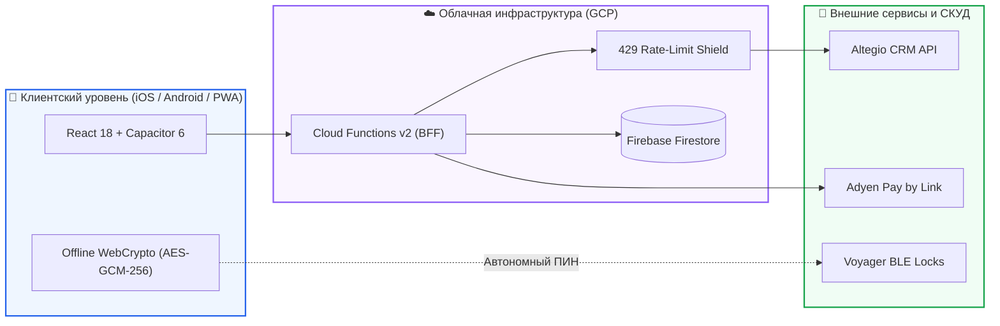

# Привет, я Павел.
### Full-Stack & Mobile App Developer | UI/UX Designer & System Architect

> Специализируюсь на проектировании и разработке сложных клиент-серверных веб-платформ, e-commerce систем и кроссплатформенных мобильных экосистем под ключ (iOS & Android). Закрываю полный цикл создания продукта: от прототипирования дизайн-систем в **Figma** до фронтенда, нативных мобильных модулей, серверных микросервисов, интеграций с CRM, эквайрингом и автоматизации облачной инфраструктуры.

---

### 🛠️ Стек технологий и ключевые компетенции

#### 🎨 Дизайн-системы & UI/UX Архитектура
<p>
  
  
  
  
</p>

#### 📱 Мобильная разработка (iOS & Android)
<p>
  
  
  
  
  
  
</p>

#### 💻 Web-разработка & Frontend
<p>
  
  
  
  
  
</p>

#### ⚙️ CMS, Backend & Базы данных
<p>
  
  
  
  
  
</p>

#### ☁️ DevOps, Безопасность & Финтех
<p>
  
  
  
  
  
</p>

---

### 🏆 Проекты и архитектурный опыт

#### ❄️ Флагманский проект (Production): Polar Recovery Club
*Генеральная цифровая платформа для премиального велнес-клуба контрастных процедур в Риге (Евросоюз).*



* **UI/UX Дизайн и Прототипирование:** Полное авторское проектирование дизайн-системы, компонентов и интерактивного прототипа на 13 экранов в **Figma** (раздельные сценарии для гостей и резидентов).
* **Кроссплатформенный Frontend:** Высокопроизводительное SPA/PWA на **React + Capacitor + Vite** с поддержкой Zero-Scroll архитектуры и нативной адаптации под безопасные зоны экранов (Safe Area).
* **Облачный Backend (BFF):** Микросервисная архитектура на **Google Cloud Functions v2** (регион `europe-west1`), Google Secret Manager, распределенные очереди задач Cloud Tasks и кэширование запросов для защиты от квот CRM (429 Shield).
* **СКУД и IoT-безопасность:** Аппаратный криптографический модуль генерации временных ПИН-кодов доступа на базе Web Crypto API (`AES-GCM-256`, криптографическая соль, PBKDF2) с поддержкой автономного офлайн-режима при сбоях сети контроллера.
* **Финансы и бизнес-логика:** Бесшовная интеграция с **Altegio CRM REST API**, эквайринг **Adyen Pay by Link** (Apple Pay / Google Pay), учет абонементов сети, бронирование слотов купелей и автоматическое закрытие визитов.
* **CI/CD и релизы:** Полностью автоматизированный пайплайн в **Codemagic**: сборка релизных бандлов, подписание сертификатами и прямая публикация релизов в **App Store** и **Google Play**, а также собственный движок моментальных OTA-обновлений бандла без прохождения повторной модерации в сторах ($0/мес).

<p>
  <a href="https://polar-recovery-app.web.app" target="_blank">
    
  </a>
  <a href="https://www.figma.com/proto/hgLLA1u1zRyAlIDkH8c1JG/Polar-Recovery-App?node-id=0-1&p=f&t=5V6htnUcySOuIE7m-0&scaling=scale-down&content-scaling=fixed&page-id=0%3A1&starting-point-node-id=68%3A1091&show-proto-sidebar=1" target="_blank">
    
  </a>
</p>

---

#### ☁️ Open-Source инструмент: [Cloudflare IaC Management Portal](https://github.com/mainparadox/cloudflare-manager-iac)
*Собственная веб-панель администратора для автоматизации защиты, DNS и SSL десятков сайтов в Cloudflare в 1 клик.*

**Какую проблему решает проект:**  
Когда у веб-разработчика на поддержке находится 20–30 клиентских сайтов и зеркал, настраивать безопасность и DNS вручную через панель Cloudflare превращается в рутину и приводит к ошибкам. А бесплатные сертификаты Let's Encrypt постоянно сбоят при продлении каждые 90 дней из-за блокировок WAF.

**Ключевые возможности:**
* **🔒 Пожизненный SSL на 15 лет:** Генерирует приватные ключи RSA-2048 и автоматически заказывает официальные сертификаты Cloudflare Origin CA на 15 лет (до 2041 года).
* **🛡️ Готовая WAF-защита для CMS:** В 1 клик разворачивает 5-уровневый комплекс фаервола под уязвимости движков (**Joomla, WordPress, PrestaShop**): отсекает ботов, блокирует дампы баз (`.sql`, `.zip`) и закрывает капчей вход в админку.
* **↪️ Моментальные 301-зеркала:** Перенаправление трафика на уровне серверов Cloudflare (Edge) без нагрузки на хостинг.
* **💾 Экономия диска (IaC + Terraform):** Связка Python, Jinja2 и HashiCorp Terraform v5.x. За счет умного кэширования плагинов конфигурация 25 сайтов весит менее 3 МБ (экономия 99.98% места).
* **🚑 Самоисцеление стейта:** Автоматический перехват скрытых ошибок Cloudflare API (конфликты контейнеров 20217, сбои кириллицы .бел/.рф 1010, удаленные ключи 1014).

<p>
  <a href="https://github.com/mainparadox/cloudflare-manager-iac">
    
  </a>
  <a href="https://github.com/mainparadox/cloudflare-manager-iac/fork">
    
  </a>
  
  
  
  
</p>

> ⭐️ **Понравился инструмент? [Поставьте звёздочку проекту на GitHub](https://github.com/mainparadox/cloudflare-manager-iac) — это мотивирует развивать его дальше!**

---

> 🔒 **О коммерческом портфолио (2018 — настоящее время):**  
> Значительная часть реализованных проектов (корпоративные порталы, e-commerce платформы на Joomla/PHP/MySQL, микросервисы автоматизации) находится под действием соглашений о неразглашении (**NDA**) в закрытых корпоративных репозиториях. Детали архитектурных решений и примеры кода предоставляются по запросу.

---

### 💻 Консольная выжимка профиля

<details>
  <summary><b>▶ Нажмите, чтобы выполнить <code>curl -s https://api.mainparadox.dev/v1/profile</code></b></summary>
  <br />

```json
{
  "engineer": "Pavel MX (mainparadox)",
  "specialization": "Full-Stack, Mobile (iOS/Android) & Cloud Architecture",
  "experience_focus": [
    "Capacitor 6 / Swift / Kotlin native bridges",
    "GCP Cloud Functions v2 BFF & WebCrypto",
    "PHP 8+ / MySQL / Joomla enterprise customization",
    "Cloudflare Edge Workers & Terraform IaC"
  ],
  "availability": "Открыт к сложным архитектурным задачам и разработке экосистем под ключ",
  "telegram": "@pavelmmx"
}
```
</details>

---

### 📊 Инженерная активность

<p align="center">
  <a href="https://github.com/mainparadox">
    
  </a>
  <a href="https://github.com/mainparadox">
    
  </a>
</p>

---

### 📫 Связаться со мной

<p>
  <a href="https://t.me/pavelmmx">
    
  </a>
  <a href="mailto:main.paradox@gmail.com">
    
  </a>
</p>
